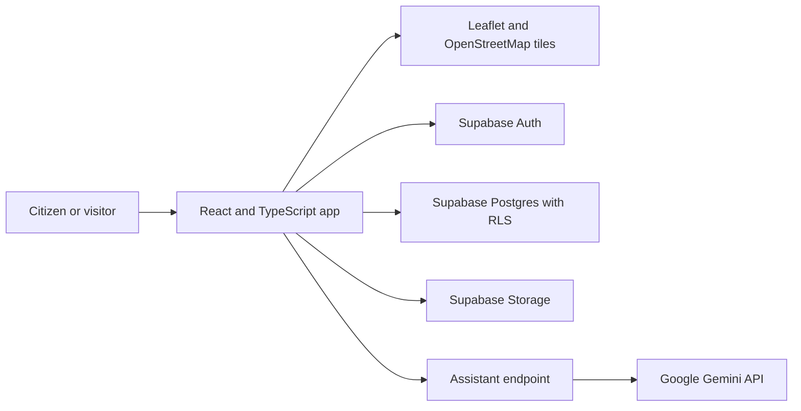

# Architecture

## Overview

CANIGO is a React single-page application. The browser handles navigation and presentation, Supabase provides optional hosted identity/data/storage, and the assistant request is handled by a server endpoint so the Gemini key need not be shipped in the client bundle.

## Browser application

- React and TypeScript components render routes, venue views, community flows and the assistant.
- Vite provides local development and the production build.
- Application context coordinates authentication state, community data and navigation.
- React Leaflet renders map UI over OpenStreetMap tiles.
- Browser Web Speech APIs provide optional speech input/output.

## Supabase

Supabase Auth handles account sign-in. Postgres tables and policies store application records and community data. Row Level Security restricts operations based on the authenticated user and application rules; storage policies control evidence object access.

The repository includes SQL migrations under `supabase/migrations`. A configured project is required to verify cloud behavior. Do not bypass RLS to make a demo work; repair the policy or data flow at the source.

## Assistant request path

The client sends a request to `/api/assistant`. In local development, Vite supplies a middleware endpoint; the deployment runtime uses the function implementation. The endpoint calls Gemini with a server-side `GEMINI_API_KEY`, parses a constrained response and exposes only supported actions to the app. The client must still validate and safely handle returned actions.

This is not Gemini Live streaming, native function calling, a general tool-execution agent, or an accessibility verification engine. AgentRouter has not been integrated.

## Deployment

The repository's GitHub Actions workflow is configured to build and deploy to Cloudflare Pages when its required Cloudflare token is available. The project name can be overridden by a repository variable. Workflow configuration alone does not establish that a deployment succeeded or identify the actual public URL; see [deployment](./DEPLOYMENT.md).
